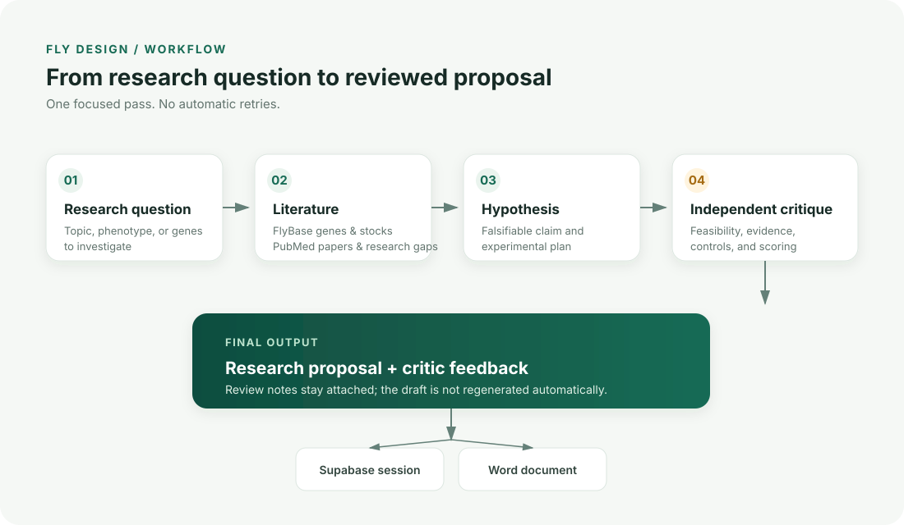

# Fly Design

Fly Design is a research studio for developing experimental proposals in *Drosophila melanogaster* genomics. Give it a research topic and a set of genes to retrieve relevant literature, draft a testable hypothesis and experimental plan, and receive an independent critique with the proposal.

## How it works



1. **Literature Retrieval** — pulls gene/stock data from FlyBase and relevant papers from PubMed for the given genes and topic.
2. **Literature Agent** — synthesizes the retrieved papers into a structured summary: relevant genes, signaling pathways, human orthologs, disease relevance, and specific gaps in current knowledge.
3. **Hypothesis Agent** — turns that synthesis into a falsifiable, quantified hypothesis with a concrete experimental plan (fly lines, GAL4/UAS design, controls, expected outcomes).
4. **Critic Agent (Gemini)** — independently scores the proposal from 1–5 on three axes: hallucination defense (no fabricated genes/papers), genetic feasibility (are the fly lines and crosses real and workable), and control reasoning. These are descriptive scores, not an automatic pass/fail decision. Using a different model family than the generator avoids shared blind spots between generator and critic.
5. **Single-pass critique** — the Critic Agent evaluates the draft once. The pipeline returns the proposal and critic feedback together; it does not automatically loop or regenerate the draft.
6. **Output** — pipeline proposals, critic feedback, and verified references are saved with the session, restored in the proposal panel, and exported as a Word document. PostgreSQL provides server-side persistence when configured; a browser-side proposal cache also supports reloads and exports without it. Literature displays identify the retrieval source and DOI when available. TF-IDF scores are labeled as text-match heuristics, not evidence-quality ratings.

### Evidence and uncertainty

Chat and proposal prompts require inline citations for literature-based claims, distinguish findings from inferences and proposed experiments, and instruct the models not to invent references or claim stock availability without evidence. Chat citations use current-turn PMID/source identifiers, then are rebuilt as numbered references from retrieved records; unmatched or legacy citation markers are removed and surfaced as a limitation. When retrieval returns no papers, the response and proposal are explicitly labeled unverified.

An automated evidence-check pass reviews factual claims in chat and proposals against retrieved titles and abstracts. Chat, planner, and pipeline proposal generation also emit structured claim records, which are combined with a separate claim-extraction pass; the review reports how many extracted factual claims received an assessment and marks incomplete coverage explicitly. Each claim is labeled inline as supported, not found, uncertain, or a proposal/prediction. Exact abstract sentences are required before showing supporting evidence. Unsupported or uncertain claims receive at most one cautious revision pass, limited to 10 claims per answer/proposal, and are checked again; automatic revision can be disabled with the persistent **Auto-revise claims** toggle. If revision or rechecking fails, the original or revised text remains visibly marked instead of being treated as verified. A quote is checked against the retrieved text in code, but the claim-to-quote judgment is still model-generated; this is a review aid, not scientific verification. The checks add model calls to each answer/proposal, with additional calls when claims need revision. Consult original sources and expert reviewers before relying on claims.

## Tech stack

- **Backend:** Flask, streamed via Server-Sent Events for live pipeline progress
- **Database:** PostgreSQL (optional; Supabase connection supported)
- **Hosting:** Render
- **LLMs:** Claude (Literature + Hypothesis agents), Gemini (independent Critic agent)
- **Literature sources:** FlyBase, PubMed (via Biopython/Entrez)
- **Export:** python-docx for Word document generation

## Project structure

```
app.py                       # Flask routes, session handling, SSE streaming
drosophila_assistant.py      # Core assistant logic, literature fetching (FlyBase/PubMed)
database.py                  # Supabase persistence
docx_export.py               # Proposal/experiment-design → Word doc export
research_planner.py          # Research planning support logic
agents/
  pipeline.py                 # Runs one Literature → Hypothesis → Critic pass
  literature_agent.py          # Synthesizes papers into structured findings
  hypothesis_agent.py          # Drafts falsifiable hypothesis + experimental plan
  gemini_critic_agent.py       # Independent critic and proposal scoring
static/index.html             # Frontend
```

## Local setup

Use Python 3.11, matching the version configured for Render.

```bash
git clone https://github.com/Jordan5342/Drosophilia-Assistant.git
cd Drosophilia-Assistant
python3.11 -m venv venv
source venv/bin/activate
python -m pip install --upgrade pip
python -m pip install -r requirements.txt
cp .env.example .env
```

On Windows, use `py -3.11 -m venv venv`, activate it with `venv\Scripts\activate`, install the requirements as above, and copy the template with `copy .env.example .env`.

Edit `.env` and add the keys you need:

```
ANTHROPIC_API_KEY=
GEMINI_API_KEY=
CLAUDE_MODEL=claude-sonnet-4-6
GEMINI_CRITIC_MODEL=gemini-2.5-flash
DATABASE_URL=
```

- `ANTHROPIC_API_KEY` is required for chat and proposal generation.
- `GEMINI_API_KEY` is required to run the independent AI critic pipeline.
- `DATABASE_URL` is optional; set it to a PostgreSQL connection string (for example, from Supabase) to enable persistence. Without it, the app runs without database persistence.
- `CLAUDE_MODEL` is optional and defaults to `claude-sonnet-4-6`. It sets the default Claude model for chat, planning, the Literature and Hypothesis agents, and the evidence check. The **Model** menu in the app header overrides it per browser (Sonnet 4.6, Sonnet 5.5 or Opus 5.5). To compare models on the same topics, run `CLAUDE_MODEL=claude-opus-5-5 python run_calibration.py --topics-from topics.json --out opus.json`; the output records which model was used.
- `GEMINI_CRITIC_MODEL` is optional and defaults to `gemini-2.5-flash`.

The application loads `.env` automatically. Keep real keys in `.env` or your deployment's secret settings; do not commit them.

Start the app:

```bash
python app.py
# or (creates/uses the repository's venv folder)
./start.sh
```

On Windows, run `start.bat`. Open http://localhost:5000. To run the focused regression tests:

```bash
python -m unittest discover -s tests
```

## Render deployment

The included [render.yaml](./render.yaml) configures the Python 3.11 web service and install/start commands. Add `ANTHROPIC_API_KEY` and `GEMINI_API_KEY` as Render secrets to enable chat and the critic pipeline. Add `DATABASE_URL` as a secret if database persistence is needed. `CLAUDE_MODEL` and `GEMINI_CRITIC_MODEL` can be overridden in the service environment.

## Status

Actively in development.

## Credits

Built by Jordan Sztejman
